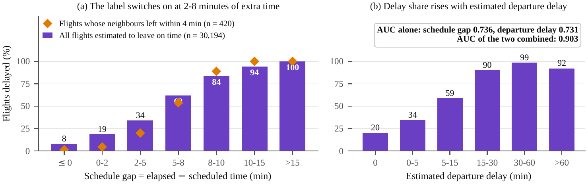
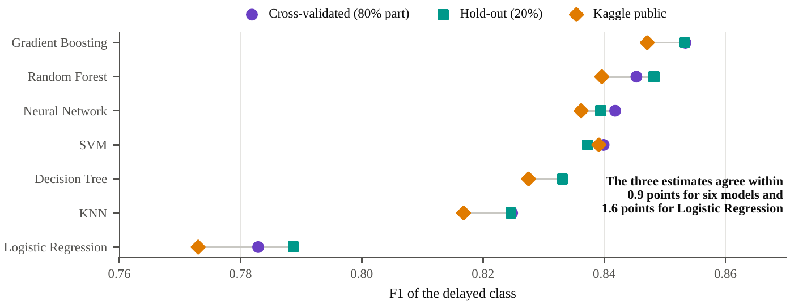
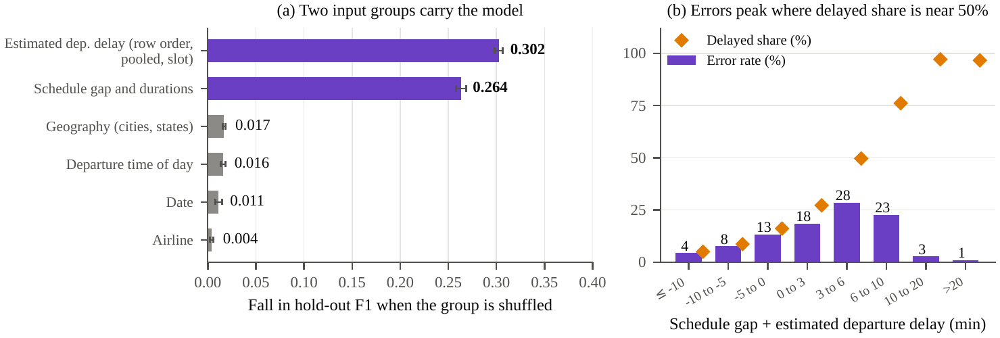

# Flight Arrival Delay Prediction

Seven classifiers predicting whether a flight arrives delayed. The project is built around a feature-engineering discovery that lifted every model's F1 by 14 to 18 points on the hold-out (17 to 19 points on Kaggle), far more than tuning, a wider search or ensembling did (0.5 points or less together).

**Task.** Binary classification of `Arrival_Delay` (1 = delayed, 0 = not delayed) on 42,634 labelled flights, scored by the F1 of the delayed class. The final models were scored on 21,318 unlabelled flights through a Kaggle competition.

## The interesting part

The two data files turned out to be sorted by scheduled departure time. A flight that left late appears "out of place" in that order, so its departure delay can be estimated from row position alone, a column the files never actually give you.



The estimated departure delay and the observed schedule gap each reach an AUC of only about 0.73 on their own, but together they reach 0.903, because a flight arrives late when its departure delay and its extra time on the route add up to more than a few minutes. Without the engineered features every model scores 0.63 to 0.66 F1 on the hold-out. With them, the models score 0.79 to 0.85. The derivation and evidence are in the report.

## Results

F1 of the delayed class, sorted by Kaggle score. Cross-validation and hold-out use an 80/20 split of the labelled file. Kaggle is the public leaderboard score on the unlabelled file.

| Model | Cross-val F1 | Hold-out F1 | Kaggle F1 |
|---|---|---|---|
| **Gradient Boosting** | **0.853** | **0.853** | **0.8471** |
| Random Forest | 0.845 | 0.848 | 0.8396 |
| SVM (RBF) | 0.840 | 0.837 | 0.8391 |
| Neural Network | 0.842 | 0.839 | 0.8362 |
| Decision Tree | 0.833 | 0.833 | 0.8275 |
| KNN | 0.825 | 0.825 | 0.8168 |
| Logistic Regression | 0.783 | 0.789 | 0.7730 |



For Gradient Boosting, shuffling the columns that carry the row-order and pooled information lowers hold-out F1 by 0.30, and shuffling the schedule gap and duration columns lowers it by 0.26. Airline, date and geography matter little.



## Method, in brief

- 80/20 stratified train/hold-out split. Every model is tuned by randomised search with cross-validation on the training part only.
- Tuned for F1, not accuracy, with the decision cut-off chosen from out-of-fold predictions instead of being fixed at 0.5. On the first Decision Tree, tuning for F1 and choosing the cut-off this way moved the Kaggle score from 0.6044 to 0.6407.
- Row-order and pooled departure-delay estimates are computed from departure times and file order only, never from labels, and are fed to the models next to the raw and derived columns.
- The feature groups (base, row order, pooled, 5-minute slots) are added one at a time for all seven models to measure what each group contributes. The report has the full table.

## Limitations

- The row-order features depend on how the supplied files were assembled (sorted by scheduled departure time). They would not carry over to data without that order, and a deployed system would use the scheduled departure time directly.
- Several inputs (elapsed time, air time, wheels-on time, taxi-in time) are only known during or after a flight. The scores describe retrospective classification of completed flights, not early forecasting.
- The row-order and pooled features are built from the supplied files before the split, without labels, so the evaluation assumes each day's flight lists are available at once.

## Repository structure

```
notebook/
  flight_delay_models.ipynb   shared preprocessing, then tuning, cut-off and hold-out for all seven models
report/
  report.pdf                  full write-up: EDA, the hidden-structure finding, method, results, discussion
  report.tex                  LaTeX source (compiles with pdfLaTeX)
  figures/                    the nine figure PDFs that report.tex includes
figures/                      PNG copies of three key charts, used in this README
requirements.txt
```

## Running it

The raw data files are not included. They were supplied for a university assignment and are not mine to redistribute. To run the notebook, place the three course files next to it:

- `Assignment3-Flight-Dataset.csv` (labelled flights)
- `Assignment3-Unknown-Dataset.csv` (flights to predict)
- `Assignment3-Kaggle Submission-Sample.csv` (submission format)

The notebook finds them by name pattern. To keep them elsewhere, change `DATA_DIR` in the first code cell.

```bash
pip install -r requirements.txt
jupyter notebook notebook/flight_delay_models.ipynb
```

Running all seven models takes about 30 minutes on a two-core machine. The notebook writes a Kaggle file for every model: the Gradient Boosting predictions as `gb_predictions.csv` and the other six in an `other_models/` folder.

## Report

[`report/report.pdf`](report/report.pdf) has the exploratory analysis, the row-order discovery and why it works, the tuning and validation protocol, notes on each model, an error analysis of the best model, and the limits of the finding. To rebuild it, compile `report/report.tex` with pdfLaTeX, keeping the `figures/` folder next to it.

---
Built as a university data analytics course project. Models: Decision Tree, KNN, Random Forest, SVM, Neural Network, Gradient Boosting and Logistic Regression, all from scikit-learn.
